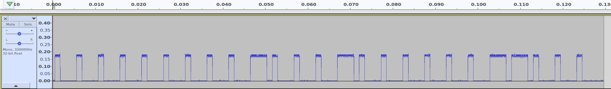

# Signal analysis and reverse engineering

The Gazco analysis began in 2017–2018. The retained workflow screenshots are
from the later Sonte session in February 2019. They illustrate the analysis
process; they are not Gazco captures or a new validation of the current code.

## Capture a waveform

Use an SDR receiver with a supported SDR#/HDSDR/GNU Radio input to record the
remote's signal. The YARD Stick One/RfCat packet interface used by these
controllers is a separate workflow; `RFrecv()` returns packet bytes and a
timestamp, not the raw sample stream expected by Audacity.

1. Record the carrier setting, receiver model, gain, and sample rate.
2. Capture several presses of one button and retain the original recording.
3. For OOK pulse analysis, produce an amplitude/envelope waveform, for example
   with GNU Radio's Complex to Mag block. Record any resampling or filtering.
4. Import that waveform using its actual format and sample rate. Do not import
   interleaved complex IQ or packet bytes as a mono float waveform.
5. Measure high and low runs across multiple frames, including the gaps.

The historical notes use 320 kHz for timing calculations. That is an input to
those calculations, not a requirement to reinterpret every new file at 320 kHz.
This repository retains screenshots and decoded notes rather than a complete
replayable raw-capture dataset.



## Recover timing and logical bits

For Gazco, the notes record a shortest high pulse of 292 samples at 320000
samples/s. The conversion explains the preserved 1095 data-rate setting:

```python
sample_rate = 320000
shortest_high_samples = 292
print(sample_rate / shortest_high_samples)  # approximately 1095.89 units/s
```

The observed Gazco mapping is `1 → 100`, `0 → 110`: each logical bit spans
three high/low units. Interpret a high pulse with its associated low interval;
a threshold applied indiscriminately to every run is not a complete decoder.
For another capture, remeasure the runs instead of assuming the same sample
counts. The proposed preamble/address fields remain hypotheses.

## Inspect conversion and recorded bytes

The optional conversion utilities calculate PWM encodings. They do not produce
the complete preserved transmit bursts, which contain historical additional
bytes, padding, and repetition. From the repository root:

```bash
python -m pip install bitstring
python gazco-fireplace/code/utils/convert_gazco.py
python sonte-smart-film/code/sonte_signal_analyzer.py
```

The Gazco utility currently demonstrates DOWN; the Sonte utility demonstrates
the key in its source. Neither sends radio traffic. To inspect the exact
controller bursts without installing any dependencies:

<!-- offline-smoke -->
```bash
python gazco-fireplace/code/controller.py up --dry-run
python sonte-smart-film/code/sonte_controller.py original --dry-run
```

See [the Gazco reference](PROTOCOL.md) and
[transmission provenance](../../TRANSMISSIONS.md) for the difference between
encoded keys and preserved bursts.

## Validation

Run `python -m unittest discover -s tests -v` from the repository root for the
offline fixture, status, and cleanup checks. They verify software behavior and
byte preservation. They do not verify reception, on-air spacing, RF power, or
physical target response.

For a later hardware validation, record the installed firmware, controller
profile, measured waveform, and observed target response. Keep those results
separate from the earlier historical observations. Use the existing controller
entry points and their checked send path, rather than rebuilding transmission
loops from illustrative encoding snippets.
