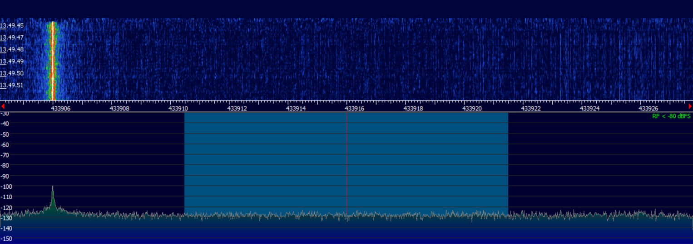
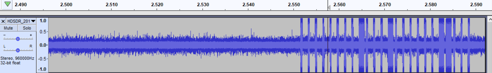
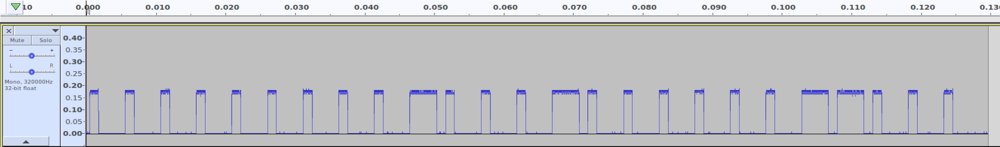
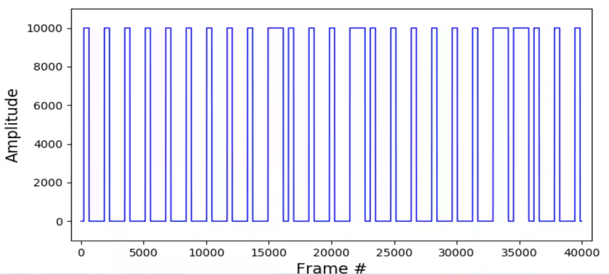
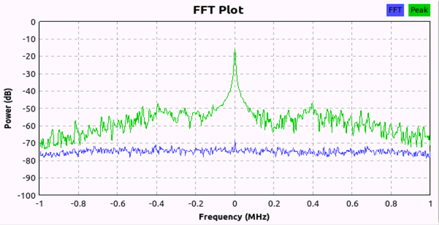

# Sonte Smart Film RF Protocol

**Reverse engineering and implementation of the Sonte smart film remote control RF protocol.**

[]()
[]()

## Overview

This project documents the author's Sonte smart film remote analysis at
433.916 MHz and the preserved controller implementation. The analysis dates to
February 2019, with screenshots illustrating the capture and decoding workflow.

The recorded keys contain 24–25 logical bits with PWM encoding
(1='1000', 0='1110'). The historical account reports successful control of film
opacity; current offline tests verify the saved bytes and software behavior.

**Documentation**: All analysis workflow screenshots in the [methodology/screenshots](../methodology/screenshots/) directory are from this project, captured during the February 3, 2019 analysis session. These screenshots provide a complete visual guide to the RF reverse engineering process and are referenced throughout the methodology documentation.

## Preserved transmissions

The controller and button scripts share immutable profiles in
`code/sonte_profiles.py`. `button1` and `button2` preserve their existing bytes
and labels. `original` restores the 64-byte 2024 transmission without assigning
it a physical button meaning. See [transmission provenance](../TRANSMISSIONS.md).

## Technical Specifications

| Parameter | Value |
|-----------|-------|
| **Frequency** | 433.916 MHz |
| **Modulation** | ASK/OOK (On-Off Keying) |
| **Encoding** | PWM (Pulse Width Modulation) |
| **PWM Mapping** | 1='1000', 0='1110' |
| **Decoded command length** | 24-25 logical bits; separate from the RFcat FLEN byte setting |
| **Data-rate setting** | 2500 symbols/s |
| **Recorded controls** | Two fixed button patterns; channel semantics are not inferred |

## Command Protocol

### Discovered Commands

The Sonte remote has two buttons for controlling smart film state:

| Button | Function | Binary Key |
|--------|----------|------------|
| **Button 1** | Transparent | `1111111110111011111100111` |
| **Button 2** | Opaque | `111111110111011111111101` |

### PWM Encoding Details

The protocol uses a more complex PWM encoding compared to simpler 433 MHz devices:

```
Binary '1' → PWM '1000' → One high unit + three low units
Binary '0' → PWM '1110' → Long high + very short low

Each logical bit occupies four high/low units.
```

The table retains the historical button labels and decoded keys. Current
regression tests preserve their recorded bytes; they do not reverify the
physical transparent/opaque mapping or establish comparative noise immunity.

**Example Command Structure**:
```
Full PWM key pattern (Norwegian comment in code):
"Fullstendig PWM key" = Complete PWM key
"Fjernkontrollens key" = Remote control's key
```

## Analysis Workflow (February 2019)

This project was documented systematically with screenshots at each analysis phase. The complete workflow is detailed in the [methodology](../methodology/) directory.

### Phase 1: Frequency Discovery


*SDR# waterfall display showing the 433.916 MHz signal. Note the clear vertical lines indicating button press transmissions in the ISM band.*

**Key Observations**:
- Recorded controller frequency setting: 433.916 MHz
- Clean signal with minimal adjacent interference
- Consistent timing between packet bursts
- Multiple repetitions per button press

### Phase 2: Raw Signal Capture


*HDSDR showing the raw ASK/OOK modulation envelope. The on-off keying pattern is clearly visible as amplitude variations.*

**Capture Parameters**:
- Sample rate: 320 kHz
- Modulation: AM (for OOK demodulation)
- Recording format: WAV audio for timing analysis
- Multiple button presses captured for comparison

### Phase 3: PWM Pattern Analysis


*Audacity timeline showing detailed PWM pulse timing. This zoomed view reveals the 1='1000' and 0='1110' encoding pattern through pulse width measurements.*

**Analysis Process**:
- Import demodulated signal into Audacity
- Zoom to individual pulse level
- Measure pulse widths in samples
- Identify two distinct patterns
- Map patterns to binary values

**Timing interpretation at the preserved data-rate setting**:
```
At 2500 symbols/s, one high/low unit is 0.4 ms:
  Logical 1 (1000): high 0.4 ms, low 1.2 ms
  Logical 0 (1110): high 1.2 ms, low 0.4 ms
```

These durations follow from the setting and mapping; they are not new
measurements of the screenshots or the installed dongle's output.

### Phase 4: Signal Processing


*Python-based signal processing using matplotlib and numpy. Shows the automated binary extraction from the demodulated waveform.*

**Processing Pipeline**:
```python
# Pseudo-code from analysis session
samples = load_wav_file('sonte_capture.wav')
threshold = calculate_threshold(samples)
binary = samples > threshold
pulses = measure_pulse_widths(binary)
decoded = map_pwm_to_binary(pulses)
```

### Phase 5: Frequency Domain Validation


*Retained GNU Radio FFT view from the historical workflow. Its relative
frequency axis needs receiver tuning metadata to establish an absolute carrier.*

**Historical interpretations and current limits**:
- The recorded controller setting is 433.916 MHz.
- Earlier documentation described approximately 5 kHz bandwidth and SNR above
  25 dB. The retained screenshot alone does not establish those measurements
  or their method; retain them as historical reports pending supporting data.
- No current emissions measurement is included. The screenshot cannot establish
  an absence of spurious emissions or regulatory compliance.

## Implementation

### Programmatic control

From the `code` directory:

```python
from sonte_controller import SonteController

controller = SonteController()  # No radio opened until send_command.
if not controller.send_command('original'):
    raise RuntimeError('Sonte transmission could not be submitted')
```

The send path idles the radio after success or failure. The original complete
64-byte burst is kept separate from the two existing 79-byte button profiles;
no button mapping is inferred from their labels or calculated keys.

### Usage Examples

```bash
# Control smart film state
cd code
python sonte_controller.py button1    # Make film transparent
python sonte_controller.py button2    # Existing opaque label
python sonte_controller.py original --dry-run  # Inspect the older transmission

# Or use individual button scripts
python sonte_button1_transparent.py
python sonte_button2_opaque.py
```

## Hardware Requirements

### For Control
- **RfCat Device**: YARD Stick One or cc1111-based USB dongle
- **Target Device**: Sonte smart film installation
- **Computer**: Python 3.11+ with RfCat support

### For Analysis
- **SDR Receiver**: RTL-SDR, HackRF, or similar
- **433 MHz Antenna**: Quarter-wave (17.3 cm) or better
- **Analysis Software**: SDR#, HDSDR, GNU Radio, Audacity

## Project Timeline

**Analysis Session: February 3, 2019**

The historical documentation describes one focused session, with this reported
schedule. The exact hours are retained as the author's account rather than
independently established from the screenshots:

- **09:00-10:30**: Frequency discovery and signal capture
- **10:30-12:00**: PWM pattern analysis and decoding
- **12:00-13:30**: Python implementation and testing
- **13:30-14:30**: Validation and documentation

The five workflow screenshots are attributed to this session. They illustrate
its stages but are not a complete raw-capture dataset or a new hardware test.

## Comparison with Gazco Project

| Aspect | Sonte (This Project) | Gazco Fireplace |
|--------|---------------------|------------------|
| **Frequency** | 433.916 MHz | 433.876 MHz |
| **PWM Encoding** | 1='1000', 0='1110' | 1='100', 0='110' |
| **Baud Rate** | ~2500 Hz | 1095 Hz |
| **Bit Length** | 24-25 bits | 23 bits |
| **Documentation** | Fully documented with screenshots | Retrospective documentation |
| **Timeline** | February 2019 | 2017-2018 |
| **Language** | Norwegian comments | English comments |

Both projects used identical methodology and tools, demonstrating the repeatability of the RF reverse engineering process.

## Methodology Reference

This project serves as the reference implementation for the [RF Reverse Engineering Methodology](../methodology/README.md) documented in this repository. All workflow screenshots and detailed process descriptions are based on this February 2019 analysis session.

The capture-and-compare approach can be reused, but other devices may differ in
framing, checksums, addressing, timing, and stateful protocols as well as carrier
and encoding. The preserved settings apply to these recorded transmissions.

## Testing & Validation

Run `python -m unittest discover -s tests -v` from the repository root.
Hardware-free fixtures verify exact bytes, settings, one-burst calls, wrapper
agreement, failures and cleanup. The `original` fixture comes from the 2024
script, not an inferred button mapping.

No new hardware test was performed. The retained fixtures do not establish
STOP/PROG commands, range, emissions, or oscilloscope validation. Current target
response and the mapping of `original` still require a separate hardware check.

## Safety & Legal

**Safety Considerations**:
- Smart film operates on 110/220V AC power
- Do not interfere with building electrical systems
- Test in controlled environment
- Maintain manual remote as backup control

**Legal Compliance**:
- Check the applicable RF requirements for the equipment and location
- For educational and personal use only
- Only control devices you own

## Code Structure

```
sonte-smart-film/
├── README.md              # This file
└── code/
    ├── sonte_controller.py            # Controller and CLI
    ├── sonte_profiles.py              # Shared immutable recorded bursts
    ├── sonte_button1_transparent.py   # Button 1 (make transparent)
    ├── sonte_button2_opaque.py        # Button 2 (make opaque)
    └── sonte_signal_analyzer.py       # PWM analysis utility
```

**Note**: The actual code files contain Norwegian language comments from the original development session.

## Future Enhancements

Potential improvements for this project:

- [ ] Multi-channel support for multiple film installations
- [ ] Home automation integration (Home Assistant, MQTT)
- [ ] Scheduling based on time of day / sunlight
- [ ] API for mobile app control
- [ ] Group control for multiple rooms
- [ ] Translation of Norwegian comments to English

## Troubleshooting

### Device Not Responding

**Verify frequency accuracy**:
```python
import rflib
d = rflib.RfCat()
d.setFreq(433916000)
frequency, register_hex = d.getFreq()
print(f"Configured frequency: {frequency} Hz")
# Compare the quantized register setting with the intended 433916000 Hz.
```

**Common issues**:
- Frequency drift: Some RfCat devices need calibration
- PWM encoding error: Verify 1='1000', 0='1110'
- Repetition/padding: Compare the complete preserved profile with a fresh capture before changing its bytes
- Interference: 433 MHz band is crowded

### Analysis Issues

If attempting to replicate the analysis:
- Ensure SDR gain is appropriate (too high causes overload)
- Use 320 kHz sample rate for adequate timing resolution
- Capture multiple button presses for pattern confirmation
- Check for local interference sources

## Related Projects

- **[Gazco Fireplace](../gazco-fireplace/)**: Similar RF protocol analysis (433.876 MHz)
- **[Methodology](../methodology/)**: Complete RF reverse engineering guide
- **[RfCat](https://github.com/atlas0fd00m/rfcat)**: RF analysis toolkit used in this project

## References

- **Analysis Screenshots**: All images in [methodology/screenshots](../methodology/screenshots/)
- **Methodology Guide**: [../methodology/README.md](../methodology/README.md)
- **Main Repository**: [../README.md](../README.md)

## Acknowledgments

This project demonstrates:
- Systematic approach to RF protocol analysis
- Importance of documenting analysis process
- Repeatability of reverse engineering methodology
- Value of visual documentation (screenshots)

The lessons learned from this project informed the retrospective documentation of the earlier Gazco project.

## License

This project is licensed under the MIT License - see the [LICENSE.md](../LICENSE.md) file for details.

## Contributing

Contributions are welcome! Please see [CONTRIBUTING.md](../CONTRIBUTING.md) for guidelines.

---

**Project Status**: Recorded profiles preserved; new hardware validation pending.

**Documentation**: Reference implementation for RF reverse engineering methodology

**Language Note**: Original code contains Norwegian comments from development session
